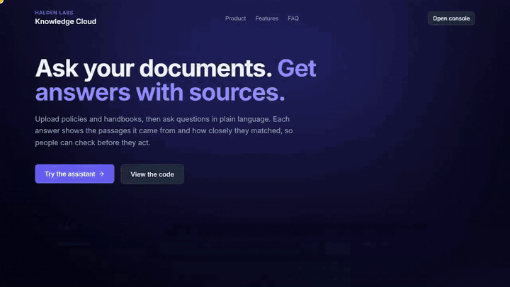
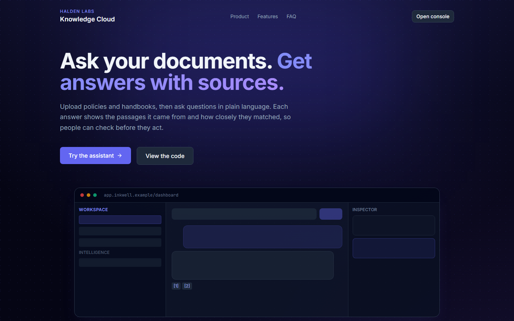
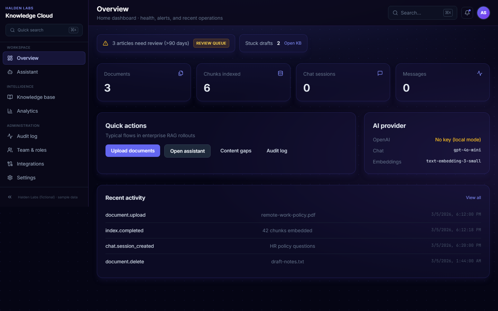
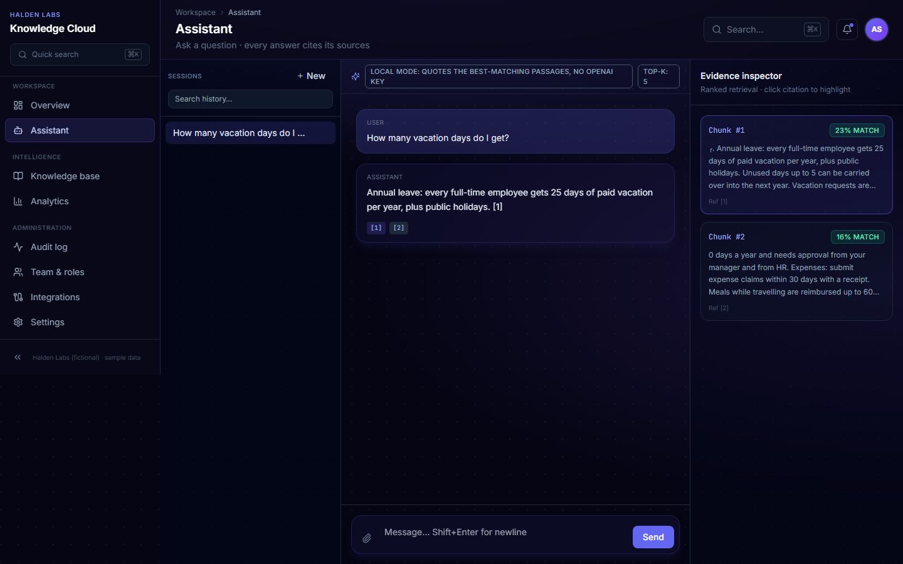
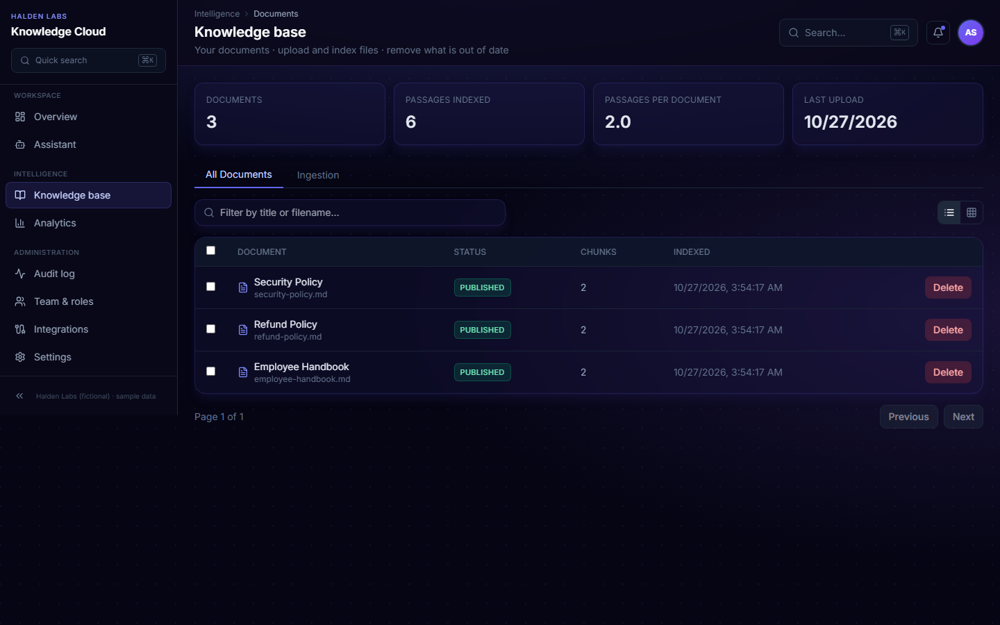
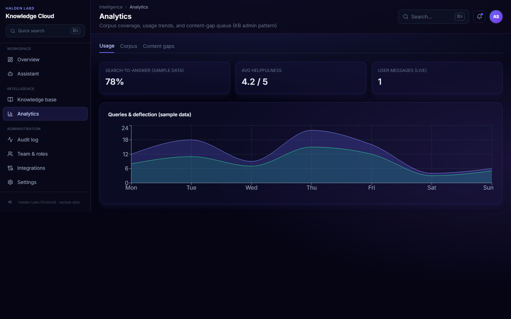

# Inkwell

Ask your documents, get answers with sources. Upload policies or handbooks, ask questions in plain language, and see the passages each answer came from with a match score.


## Video

[](docs/demo/demo.mp4)

50 seconds, recorded from the running app in local mode (no OpenAI key): the landing page, two questions answered from the sample documents with their sources, uploading a new file, and asking about it. [Watch the MP4](docs/demo/demo.mp4).

## Screenshots







## Two modes

| | Local mode (no key) | OpenAI mode (`OPENAI_API_KEY` set) |
|---|---|---|
| Embeddings | Hashed word vectors, computed in Python | `text-embedding-3-small` |
| Answer | Quotes the best-matching sentences from the retrieved passages, with `[1]` source markers | `gpt-4o-mini` writes the answer from the retrieved passages |
| Good for | Trying the whole app with no account | Questions that do not share words with the text |

Local mode matches on words (with a short synonym list), so it can miss a question phrased very differently from the document. It never invents text, because it only quotes. The console shows which mode is active.

Vectors from different modes cannot be compared. If you add a key after uploading files in local mode, upload them again.

The first start loads three made-up documents (a handbook, a security policy and a refund policy for the fictional company Halden Labs). Set `SEED_SAMPLES=false` to start empty.

## Run locally

```bash
# Backend
cd backend
python -m venv .venv
.venv\Scripts\activate   # Windows
pip install -r requirements.txt
copy .env.example .env   # OPENAI_API_KEY is optional
uvicorn app.main:app --reload --app-dir .

# Frontend
cd ../frontend
npm install
copy .env.example .env.local
npm run dev
```

- UI: http://localhost:3000
- API: http://localhost:8000/docs

## What is in it

- **Assistant**: suggested questions, source markers on every answer, an evidence panel with ranked passages and scores, session history
- **Knowledge base**: upload PDF, Markdown or text files, passage counts, delete
- **Analytics**: usage and corpus charts (some charts show sample data and say so)
- **Audit log, team and roles**: screens with sample data, not connected to the API
- **Backend**: FastAPI, SQLAlchemy, SQLite by default, `/chat`, `/documents`, `/sessions`, `/analytics`, `/health`

## Limits

- Retrieval loads every stored passage and ranks it in Python (embeddings are kept as JSON in SQLite). That is fine for a few thousand passages, and it is not a vector database.
- No login, SSO, billing or multi-tenant roles.
- The audit log and team screens are static sample data.

## Deploy

- Frontend: Vercel, with `NEXT_PUBLIC_API_URL` pointing at the API
- Backend: Railway, Fly or Render, with a persistent volume for SQLite (or set `DATABASE_URL` to Postgres)

## Tests

```bash
cd backend
pip install -r requirements.txt -r requirements-dev.txt
python -m pytest -q
```

12 tests, no API key needed: local-mode upload and cited answers, an unanswerable question, the OpenAI path with a fake client, sample-document seeding, and validation. CI also builds the frontend.

## Author

**Alexsandro Sunaga**

## License

MIT License — Copyright (c) 2026 Alexsandro Sunaga. See [LICENSE](LICENSE).
